# 项目流程图

读图说明：v1.10把完成状态、任务查询和分类作为独立的界面筛选；完成任务仍可找回。Mac分类选择控件限制两行并提供完整悬停/辅助功能名称，任务正文继续完整换行。删除先确认并复查活动身份，原生证据则按真实执行的测试身份核对，不以总数替代。

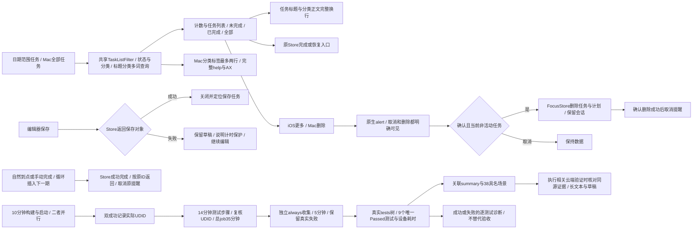

读图说明：v1.9把待办内容和动作分开，改变展示不改变任务或计时真源；云端启动和构建可重叠，运行测试前必须同时成功，结果再按真实场景绑定。

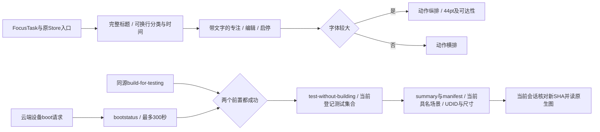

读图说明：大字体日历先让标题和范围各占一行，寻找动作时在外层留白滚动；Mac图标同时核对可解码兼容图和真实编译资源，不把特定ICNS类型当成唯一存储位置。

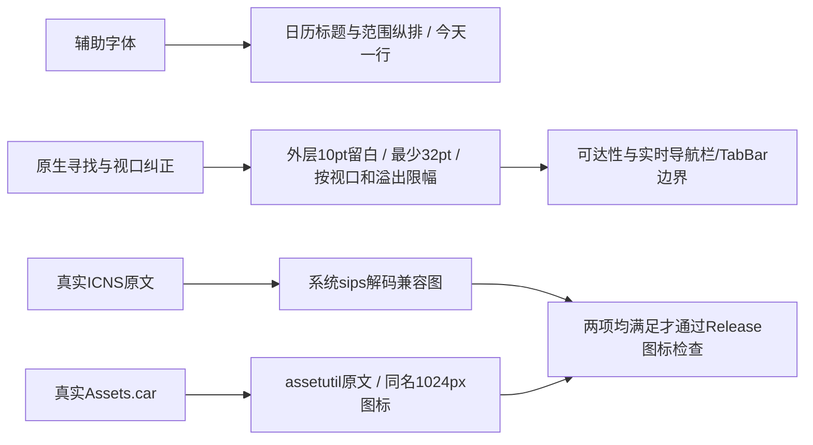

读图说明：v1.8把读取权限和过期倒计时的边界前置处理；Release工程检查复用既有来源门禁，但不把未签名构建等同于正式发行。

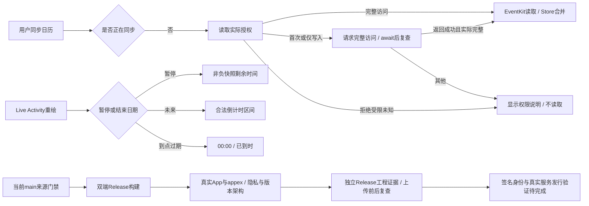

读图说明：主题沿用已有设置；分类先完成搜索与计数，再决定展示数量，收起不会修改真实分类或任务。

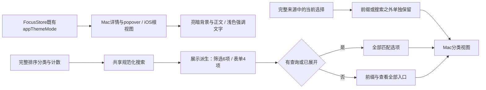

读图说明：v1.5只重排展示层，计时、任务和持久化仍由既有共享入口处理。独立UI证据与正式生产包分开上传，分别核对同一源SHA。

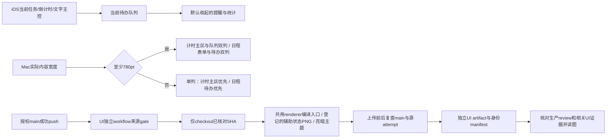

读图说明：v1.6在同一个独立UI run里分别执行Mac静态布局与两种iPhone原生交互，三份平台证据不进入生产结果包。新安装与清空后的空数据不再触发演示任务。

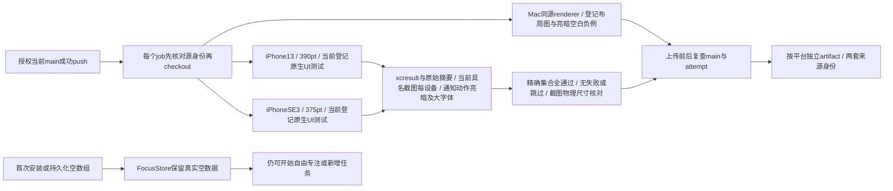

读图说明：分类搜索仅改变可见选项，选中分类与任务筛选保持独立；计数和代表色继续来自完整的原始选项。

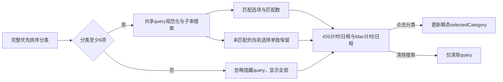

本文用 Mermaid 图展示 ChronoFocus 当前真实核心逻辑和目标驱动迭代流程。每张图前都有通俗读图说明，方便人工快速复核。

## 核心数据流

读图说明：这张图从“用户或系统输入”开始，看数据如何进入共享状态，再由计时引擎和平台服务输出到 UI、通知、Live Activity、持久化和云端测试脚本。日程使用完整 `upcomingTasks()`，计时消费使用 `startableTasks()`；已有分类选择、iOS/Mac 日期格分类计数和 iOS/Mac 计时队列展开都只属于 View 草稿/瞬态，不新增持久化或计时状态；分类代表色由预设、首个同类任务、session-only/fallback 的共享查询统一派生，选中背景文字由 `contrastTextHex(on:)` 选择，活动计时 UI 读取快照色；日期格未筛选时显示全量 `dueDate` 自然日计数，选中分类时与列表共享该分类谓词；Mac 队列从完整筛选结果派生默认前 7 项，Mac 日历范围列表从完整 `visibleTasks` 派生默认前 4 项，分类、日期、范围或结果变化时恢复收起；CI 由七个业务阶段和两个包阶段 outcome、成功/失败双 profile 和包外 run/artifact API + ZIP 证据链交给 validator 复判，finalizer 失败时先由恢复脚本重建一致 fallback 包，恢复失败不上传陈旧目录。

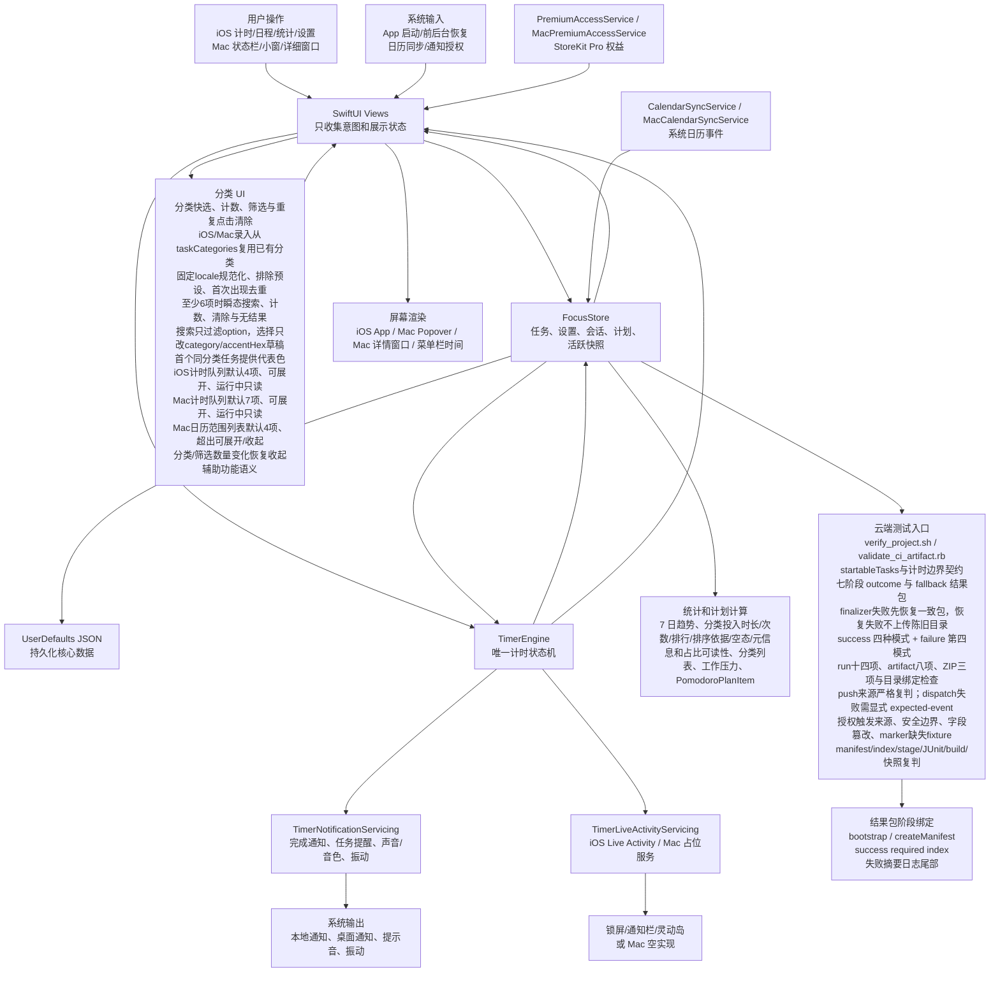

## 计时执行流

读图说明：这张图描述一次番茄钟从开始到完成的执行路径。任何新增计时行为都应该落在 `TimerEngine`，不要让 View 自己维护第二套计时规则。

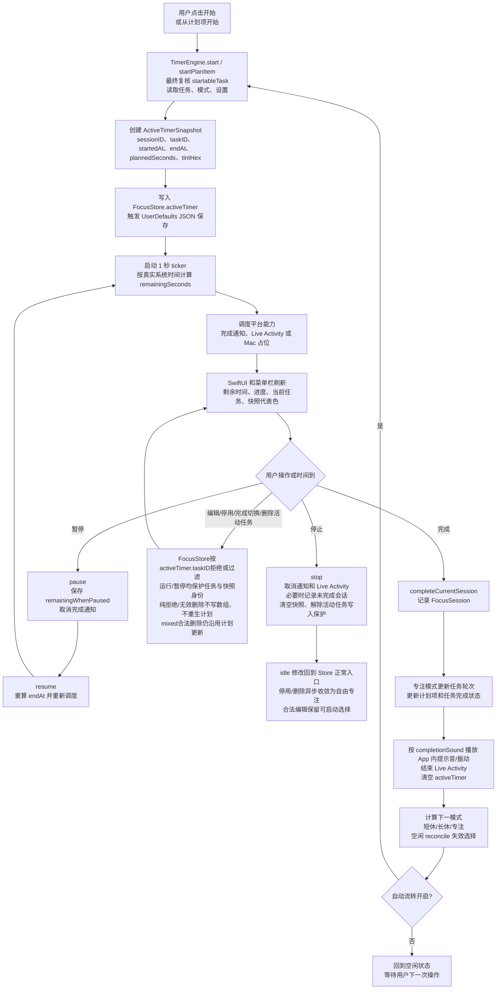

## 日程、计划和统计流

读图说明：这张图展示任务如何变成番茄钟计划，计时完成后又如何反向更新任务和统计。新增/编辑表单可从 store 的完整分类列表复用非预设分类，但选择只修改表单草稿；用户提交后才通过既有 `FocusStore` 入口持久化并刷新筛选、计划和统计。

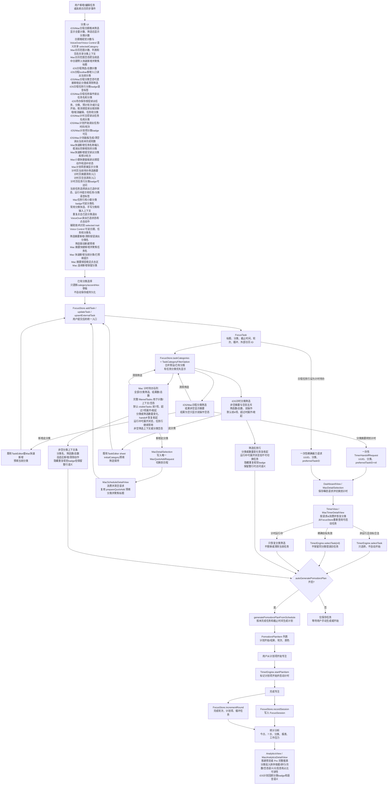

## 平台边界图

读图说明：这张图说明哪些代码可以共享，哪些只能在 iOS 或 macOS target 中使用。后续改平台能力时，先看这张图避免污染 target。

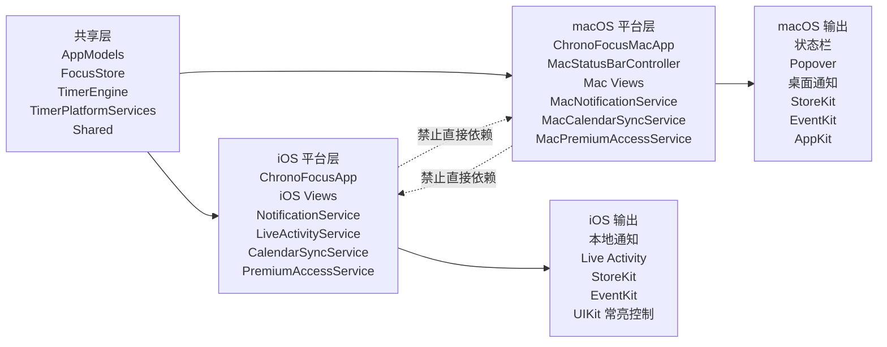

## 目标驱动迭代流程

读图说明：一个会话直接完成规划、开发、自查和结果核对，`work.md` 随步骤更新以便压缩后接续。纯文档只静态审阅；需要运行的验证默认在云端，并先按任务范围确认入口。现有完整 workflow 尚无按任务 profile，不能把计划选择误称为已实现自动裁剪。

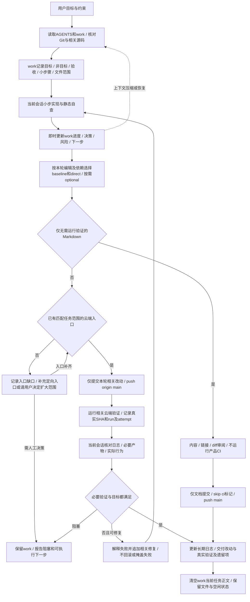

## 完整产品链与独立证据核对

读图说明：这张图仅描述当前已接线的完整产品 workflow，不代表每个小任务都应执行。它在生产 push 后自动带出全部 UI/Release 矩阵；只需要定向验证时必须先有真正支持的入口。正式 review 仍在只读 Actions 中执行，不在本机运行 validator，也不要求另一个模型或角色接手。

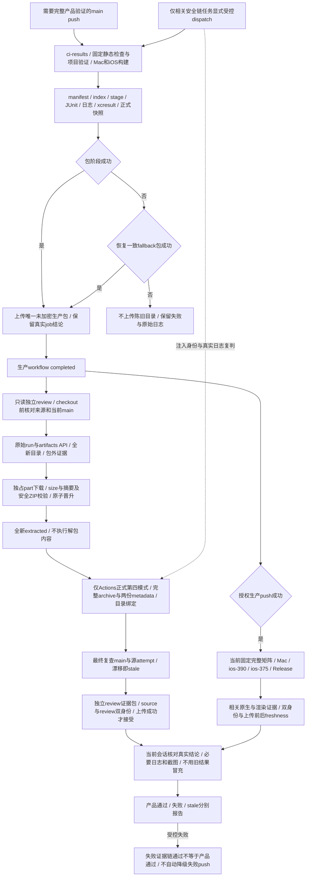
